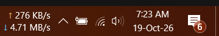

# Network Speed Monitor

A small Windows taskbar readout of your current upload and download speed, with a mini live graph and a local
usage report. It makes no network connections and sends nothing anywhere.



## What it does

- Shows upload (top line) and download (bottom line) speed next to the notification area, updated every second,
  with an optional mini graph of the last minute. Follows the Windows light/dark taskbar theme.
- **Automatic** adapter mode follows whichever adapter carries your internet traffic, or pin a specific adapter.
  Speeds in bytes (default) or bits; arrows or U/D letters; primary taskbar only or all taskbars.
- Left-click the readout to open the usage report. Right-click it for the adapter, units, graph and letters
  options, **Open report…**, **Settings…** and **Exit**.
- The report has **Summary**, **Timeline**, **Adapters** and **Wi-Fi networks** tabs, a period picker (today,
  yesterday, this week, last week, this month, last month, last 30 days, this year, all time, or a custom range)
  and **Export CSV…**. You can rename or hide
  an adapter and clear the history of one adapter, one network or everything.
- Records usage per hour while it runs (hourly rows kept 90 days, then rolled up to daily). Traffic while the app
  isn't running is not counted.
- Starts with Windows by default; turn that off in **Settings…**.

## CSV export

**Export CSV…** in the report saves the selected period, for every adapter and network, as UTF-8 with columns
`start_local, granularity, series, adapter_id, adapter_name, adapter_kind, network, received_bytes, sent_bytes`
(one row per hour, or per day for history older than 90 days).

The `series` column says what a row counts. `internet` rows are your internet traffic, through whichever
adapter carried it; `adapter` rows are each adapter's own traffic, so a VPN and the Wi-Fi it runs over both
count. The two series overlap: don't add up rows across series. Filter on one series first; `internet` matches
the report's headline numbers.

Network and adapter names come from outside the app (anyone can name a Wi-Fi network), so a name that starts
with `=`, `+`, `-`, `@`, a tab or a carriage return is written with a leading `'`. Spreadsheets then show it as
text instead of running it as a formula.

## Install

Requires Windows 10 or 11 (x64 or ARM64). No administrator rights are needed; it installs per user.

- **winget** (once the package is published): `winget install NetworkSpeedMonitor.NetworkSpeedMonitor`
- **Installer:** download `NetworkSpeedMonitor-<version>-x64-setup.exe` (or `-arm64-`) from the
  [Releases](../../releases) page and compare its hash with `SHA256SUMS.txt`. Releases are unsigned until code
  signing is approved (see [docs/signing.md](docs/signing.md)), so SmartScreen may warn.

Uninstalling asks whether to delete your usage history; a silent uninstall keeps it.

## Privacy

No network connections, no telemetry, no accounts. Your data stays in `%LOCALAPPDATA%\NetworkSpeedMonitor`.
Details and how to delete it: [PRIVACY.md](PRIVACY.md).

## Build

Needs Visual Studio 2022 (or its Build Tools) with the C++ workload, and CMake 3.25 or newer. From a
"x64 Native Tools" or Developer PowerShell prompt:

```
cmake -S . -B build -G "Visual Studio 17 2022" -A x64
cmake --build build --config Release
build\tests\Release\nsm_tests.exe
```

The app is `build\src\ui\Release\NetworkSpeedMonitor.exe`. Use `-A ARM64` for an ARM64 build (tests don't run
there). See [CONTRIBUTING.md](CONTRIBUTING.md) for details.

## License

MIT, see [LICENSE](LICENSE). Third-party code: [THIRD_PARTY_NOTICES.md](THIRD_PARTY_NOTICES.md).
